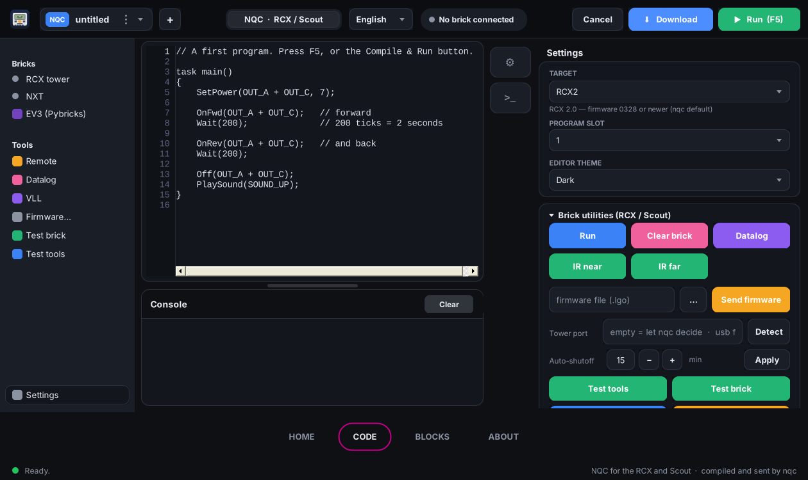
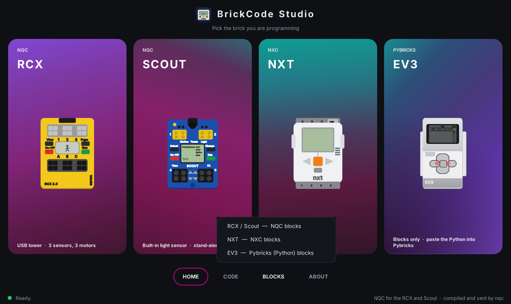
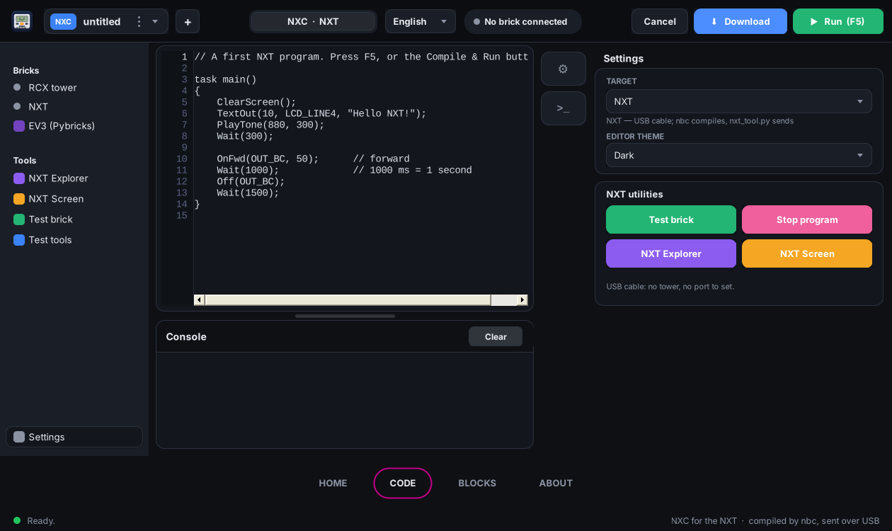
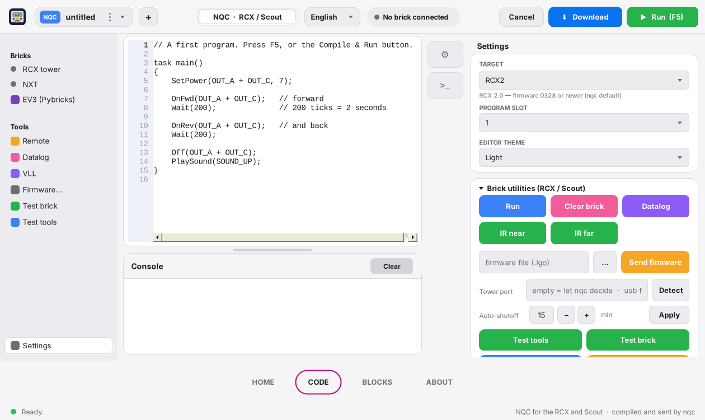
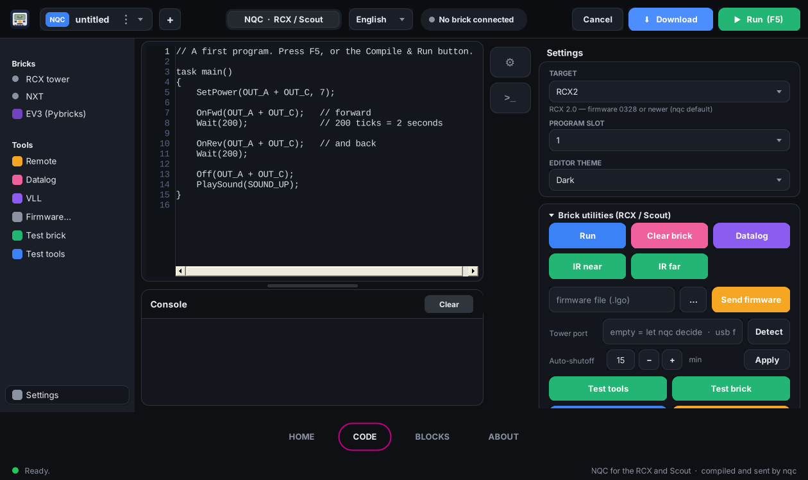
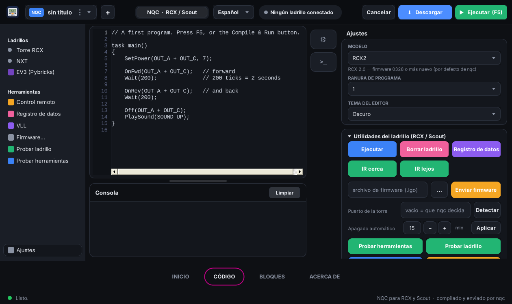
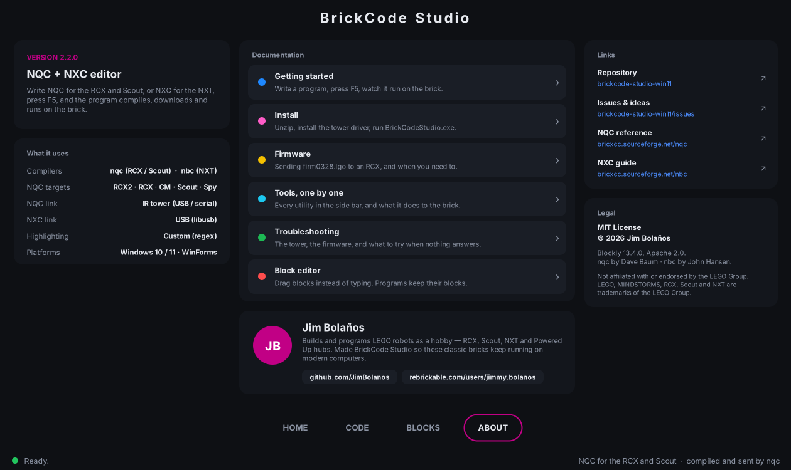

# BrickCode Studio Win11

Un editor para el LEGO RCX, el Scout y el **NXT**, para **Windows 10 y 11**, con
acceso al editor de bloques del **EV3** (Pybricks). Escribe un programa, pulsa **F5**,
y se compila, se descarga y se ejecuta en el ladrillo: `nqc.exe` para RCX y Scout,
`nbc.exe` y una herramienta USB para el NXT.

Esta es la versión para Windows de [BrickCode Studio](https://github.com/JimBolanos/brickcode-studio-apple-linux),
con la misma interfaz y los mismos editores visuales de bloques. Trae todo lo que necesita: los compiladores, los firmwares del RCX, las librerías
USB y el driver de la torre.

> Continúa a [rcx-tower-gui](https://github.com/JimBolanos/rcx-tower-gui), la versión
> anterior de la misma idea.




¿Prefieres arrastrar bloques a escribir? **Archivo → Editor de bloques…** lo abre en
tu navegador. Escribe el NQC por ti, y en esta edición viene fijado a NQC: el paquete
trae `nqc` y no `nbc`, así que ofrecer NXC aquí solo serviría para armar programas que
esta app no puede compilar.


El botón **BLOQUES** de la barra inferior primero pregunta qué editor quieres:



---

> **Aún no probado en Windows ARM.** Esta versión se ha usado en Windows 11 sobre un PC
> x64 normal. No se ha probado en Windows para ARM (portátiles Snapdragon, Surface
> Pro X y similares). Puede que funcione con la emulación x64 de Windows, pero la DLL
> de libusb y los drivers USB de abajo (libusbK, WinUSB) son lo más probable que
> falle ahí. Si lo pruebas, cuéntanos cómo te fue.

---

## Hace falta la torre infrarroja de LEGO

El RCX y el Scout **no tienen cable de datos**. El ladrillo no trae puerto USB ni
nunca lo tuvo. Todo — tu programa, el firmware, los comandos del control remoto —
viaja como **luz infrarroja**, igual que el control de un televisor.

Así que la torre no es un accesorio, es la única entrada:

```
   tu PC  ──USB──▶  torre IR de LEGO  ))) infrarrojo (((  ▶  RCX / Scout
```

Sin ella, este editor escribe y compila NQC perfectamente, pero nada llega nunca al
ladrillo.

### Las dos torres

| | Torre USB | Torre serial |
|---|---|---|
| Pieza LEGO | `x431c01` | `9713` |
| Venía en los sets | 3804, 9786, 9794 | 9719, 9785, 9790, 9793 |
| Conector | USB | serial DE-9 |
| Alimentación | del propio USB | **necesita una pila de 9 V** |
| ID USB | `0694:0001` | — |
| En Windows 10/11 | necesita el driver libusbK (Zadig, va incluido) | funciona como siempre |
| En esta app | `nqc` compila, `rcx_tool.py` envía | `nqc` hace todo |

La USB es la común en el mercado de segunda mano y es para la que está preparado este
paquete. Si tienes la serial, sirve un adaptador USB-a-serial; escribe su puerto COM en
**Puerto de la torre** dentro de Ajustes y la app usará `nqc` para todo.

### Para que el ladrillo responda

- Enciende el RCX — la pantalla tiene que mostrar algo.
- Apunta la **ventanita infrarroja** del ladrillo a la de la torre, a unos 10–25 cm.
- Que queden de frente. El infrarrojo es direccional y rebota en las paredes.
- Evita el sol directo o un fluorescente justo encima; los dos tapan la señal.
- Pilas nuevas en el ladrillo. Un RCX cansado contesta el ping y luego falla a la
  mitad de subir el firmware.

Pulsa **Probar ladrillo** en la app para comprobar todo esto antes de culpar al
software.

---

## Cómo usarlo

Llévate la carpeta [`package/BrickCodeStudio`](package/BrickCodeStudio) completa — ahí
está todo: el editor, `nqc.exe`, los firmwares del RCX, pyusb, libusb y el instalador
del driver. Lo único que pones tú es **Python 3 desde la Microsoft Store**.

1. Conecta la torre USB infrarroja.
2. Instala el driver de la torre: `driver\zadig-2.9.exe`, siguiendo
   [`driver/LEEME-driver.txt`](package/BrickCodeStudio/driver/LEEME-driver.txt).
3. Abre `BrickCodeStudio.exe`.
4. Pulsa **Probar herramientas** — debe encontrar nqc.exe, python, rcx_tool.py,
   libusb-1.0.dll y pyusb.
5. Pulsa **Probar ladrillo** con el RCX encendido y apuntando a la torre.

No instala nada, y no escribe fuera de
`%APPDATA%\BrickCodeStudio\settings.txt`, donde recuerda el tamaño de la ventana,
el idioma, el tema, el modelo y el puerto de la torre.

Si solo quieres el editor, `dist/BrickCodeStudio.exe` es el .exe pelado; pon
`nqc.exe` a su lado.

## Sobre la torre USB en Windows 10 y 11

`nqc` abre la torre como `\\.\LEGOTOWER1` — el driver propio de LEGO, que nunca se
firmó para Windows 10 ni 11 de 64 bits. Así que **nqc por sí solo no puede descargar
al ladrillo en un Windows moderno**, hagas lo que hagas.

La salida, la que encontró [beckmx](https://github.com/beckmx/lego-tower-rcx), es
asignarle a la torre el driver **libusbK** con Zadig y hablarle desde Python. Por eso
en esta versión:

- **nqc.exe compila** — esa parte está intacta y funciona perfecto.
- **`rcx_tool.py` lleva el programa al ladrillo** a través de libusbK.

Los dos los maneja la app; tú nunca escribes ninguno de los dos comandos. pyusb va
incluido, así que no hay que hacer `pip install`.

**Con torre serial nada de esto aplica.** Escribe el puerto (`COM1`, por ejemplo) en
**Puerto de la torre** dentro de Ajustes y la app usa `nqc` para todo, directamente.

## Drivers: cuál, para qué ladrillo

Solo dos cosas de esta página necesitan driver, y necesitan drivers **distintos**.
Confundirlos es la forma habitual de que algo salga mal.

| Dispositivo | ID USB | Driver que necesita | Qué hacer |
|---|---|---|---|
| **Torre USB del RCX / Scout** | `0694:0001` | **libusbK** | Corre Zadig una vez, solo sobre la torre (pasos en [`driver/LEEME-driver.txt`](package/BrickCodeStudio/driver/LEEME-driver.txt)). |
| **NXT** | `0694:0002` | **WinUSB** (o cualquiera compatible con libusb) | Normalmente **nada**: si NXT-G, NXT-Scratch, BricxCC o el software de LEGO ya funcionan en el PC, el NXT ya tiene lo que necesita. Déjalo tal cual. |
| **EV3** | — | ninguno | Se programa desde el navegador (Pybricks); esta app nunca le habla por USB. |
| **Torre serial** | — | ninguno | Escribe su puerto `COM` en **Puerto de la torre** dentro de Ajustes. |

Reglas para que Zadig no haga daño:

1. **Conecta el dispositivo primero, abre Zadig después.** Zadig solo lista lo que está conectado.
2. **Ejecuta Zadig como administrador** y marca **Options → List All Devices**.
3. **Mira el ID USB antes de pulsar Install.** Para la torre debe decir `0694 0001`.
   Si dice otra cosa, vas a reemplazar el driver de otro dispositivo. Cierra Zadig.
4. **Un dispositivo a la vez.** Nunca pongas "Replace Driver" al NXT si también usas
   NXT-G o NXT-Scratch: necesitan el driver que el NXT ya tiene, y cambiarlo puede
   romperlos. Esta app no te lo pide.
5. Cuando Zadig diga *instalado correctamente*, **desconecta la torre y vuelve a
   conectarla** (en el mismo puerto) antes de probar.

### Si algo falla

| Lo que ves | Por qué | Solución |
|---|---|---|
| **Detectar** no encuentra la torre | Se conectó después de abrir la app, o Windows no terminó de cargar el driver | Conéctala, espera unos segundos y pulsa **Detectar** otra vez. Si sigue sin salir: desconecta, vuelve a conectar en el mismo puerto y **Detectar**. |
| Zadig no lista la torre | **List All Devices** está apagado, o la torre no está conectada | Márcalo; desconecta y reconecta la torre. |
| Probar ladrillo dice que no puede abrir la torre | La torre aún no tiene libusbK | Repite los pasos de Zadig; confirma `0694 0001` y **libusbK**. |
| NXT: **`Operation not supported or implemented on this platform`** | Windows dejó el USB del NXT en un estado viejo, a menudo por conectarlo mientras otro programa lo tenía abierto | **Desconecta el NXT y vuelve a conectarlo en el mismo puerto**, espera unos segundos y pulsa el botón otra vez. El driver no tiene nada malo. |
| El NXT funciona una vez y luego no responde | **Explorador NXT** o **Pantalla NXT** siguen abiertos y retienen el USB | Cierra esas ventanas y prueba de nuevo. Solo una cosa puede hablar con el NXT a la vez. |
| El NXT no aparece | BricxCC, NXT-G o NXT-Scratch lo tienen abierto | Ciérralos. En el Administrador de dispositivos comprueba que no esté en *Otros dispositivos* con una marca amarilla: eso significa que no tiene driver, y solo entonces la respuesta es Zadig (WinUSB). |
| **Probar herramientas** dice `python: NO se encontró` | Falta Python 3 | Instálalo desde la Microsoft Store. |
| **Probar herramientas** dice que falta `libusb-1.0.dll` o `pyusb` | El exe se movió fuera de su carpeta | Ábrelo desde dentro de `package\BrickCodeStudio`, con los archivos a su lado. |
| Zadig dijo *instalado* pero nada cambió | El dispositivo no se re-enumeró | Desconéctalo y vuelve a conectarlo; como último recurso, reinicia Windows. |
| Quieres devolver la torre a como estaba | | Administrador de dispositivos → desinstalar el dispositivo con **Eliminar el software de controlador** marcado → reconectar. BricxCC y `nqc -Susb` la volverán a ver, y esta app volverá a necesitar Zadig. |

Un buen orden cuando algo raro pasa: cierra los otros programas de LEGO → desconecta →
espera cinco segundos → conecta (mismo puerto) → pulsa **Probar herramientas** y luego
**Probar ladrillo**.

## La ventana

**Barra inferior** — **INICIO**, **CÓDIGO**, **BLOQUES** y **ACERCA DE**. INICIO es
donde eliges el ladrillo (RCX, Scout, NXT o EV3). BLOQUES abre un menú pequeño para
elegir el editor de bloques: RCX / Scout (NQC), NXT (NXC) o EV3 (Pybricks). Las demás
partes de abajo pertenecen a CÓDIGO.

**Barra superior** — la ficha del archivo (haz clic para Nuevo / Abrir / Guardar /
Guardar como / los editores de bloques / Inicio / Acerca de), `+` para un programa nuevo, el modo `NQC · RCX / Scout`,
el idioma, el estado del ladrillo, y **Cancelar**, **Descargar** y **Ejecutar (F5)**.

**Barra lateral** — la torre RCX con su punto de estado, y las herramientas: Control
remoto, Registro de datos, Firmware, Probar ladrillo, Probar herramientas. **Ajustes**,
abajo, abre el panel de la derecha.

**Editor** — resaltado de NQC y números de línea. Cuando `nqc` reporta un error, la
línea queda marcada y el editor se desplaza hasta ella.

**Consola** — todo lo que imprime `nqc`, debajo del comando que lo produjo.

**Panel de ajustes** — modelo (`-T`), ranura de programa (`-pgm`), tema del editor,
las utilidades del ladrillo, el puerto de la torre, el apagado automático, y una caja
de argumentos libres para `nqc` con historial con las flechas arriba/abajo.

Con el NXT elegido, el editor escribe NXC y la barra lateral y el panel cambian a las
herramientas del NXT (Probar ladrillo, Detener programa, Explorador NXT, Pantalla NXT):



| Claro | Oscuro |
|---|---|
|  |  |

## Qué ejecuta cada botón

| Botón | Torre USB (libusbK) | Torre serial (puerto COM) |
|---|---|---|
| Ejecutar (F5) | `nqc -T<m> -O prog.rcx prog.nqc` → `rcx_tool download prog.rcx <ranura>` → `rcx_tool run <ranura>` | `nqc -T<m> -S<puerto> -pgm <ranura> -d prog.nqc -run` |
| Descargar | lo mismo, sin el último paso | `nqc -T<m> -S<puerto> -pgm <ranura> -d prog.nqc` |
| Ejecutar (utilidades) | `rcx_tool run <ranura>` | `nqc -T<m> -pgm <ranura> -run` |
| Borrar ladrillo | `rcx_tool clear <ranura>` | `nqc -T<m> -pgm <ranura> -clear` |
| Registro de datos | `rcx_tool datalog` | `nqc -T<m> -datalog` |
| IR cerca / lejos | `rcx_tool near` / `far` | `nqc -T<m> -near` / `-far` |
| Enviar firmware | `rcx_tool firmware <archivo.lgo>` | `nqc -T<m> -firmware <archivo.lgo>` |
| Apagado automático | `rcx_tool sleep <minutos>` | `nqc -T<m> -sleep <minutos>` |
| Control remoto | `rcx_tool remote <máscara>` | `nqc -T<m> -raw1 D2<máscara>` |
| Probar ladrillo | `rcx_tool ping` | `nqc -T<m> -near` |
| Detectar | `rcx_tool tower` | lee `RCX_PORT` |

La caja libre de `nqc`, abajo en el panel de ajustes, siempre va directo a `nqc`, con
historial con las flechas arriba/abajo.

### El rcx_tool.py de este paquete está parcheado

Es el de [beckmx](https://github.com/beckmx/lego-tower-rcx), con dos cambios:

- **El opcode para elegir la ranura estaba mal.** Enviaba `0x51`, que es *PlaySound*;
  el opcode de Select Program es `0x91`. Por eso descargar a una ranura distinta de la
  1 nunca llegaba a donde debía. Corregido.
- Se añadieron los comandos que necesita la interfaz: `run`, `stop`, `clear`, `near`,
  `far`, `sleep`, `battery`, `datalog` y `remote`. Todos los opcodes salen del código
  de nqc (`rcxlib/RCX_Constants.h`).

[`package/patch_rcx_tool.py`](package/patch_rcx_tool.py) aplica esos cambios sobre una
copia limpia, así se ve exactamente qué se tocó.

## Idiomas

Inglés y español, desde la barra superior — toda la interfaz, los mensajes de la
consola y los diálogos.



## Compilar desde el código

```
build.bat
```

Usa el compilador de C# que viene con el .NET Framework, así que no hay nada que
instalar. El código son cinco archivos en `src/`:

| Archivo | Qué contiene |
|---|---|
| `Core.cs` | constantes, traducciones, paleta, ayudas de dibujo, el icono |
| `Controls.cs` | botones, campos, desplegables, tarjetas, el editor, la consola |
| `Chrome.cs` | barra superior, ficha del archivo, barra lateral, barra de estado |
| `Panels.cs` | panel de ajustes, ventana del control remoto, Acerca de |
| `Main.cs` | distribución, acciones y el lanzador de nqc |

El icono se dibuja por código con GDI+, portado del original en cairo, así que es el
mismo ladrillo en todos los tamaños.

`build.bat` también refresca `package\BrickCodeStudio\BrickCodeStudio.exe`, la copia
que va dentro de la carpeta lista para usar. La 2.1.2 salió con esa copia una
compilación por detrás de su propio código; ahora ya no se puede desfasar.

Para armar el zip que va en un release:

```
package.bat
```

Comprime `package\BrickCodeStudio` completa, y se niega a hacerlo si algún archivo de
`src\` es más nuevo que el exe empaquetado.

## Acerca de



---

Licencia MIT · © 2026 Jim Bolaños · [github.com/JimBolanos](https://github.com/JimBolanos)

Proyecto independiente — sin afiliación ni respaldo del Grupo LEGO.
LEGO y MINDSTORMS son marcas registradas del Grupo LEGO.
