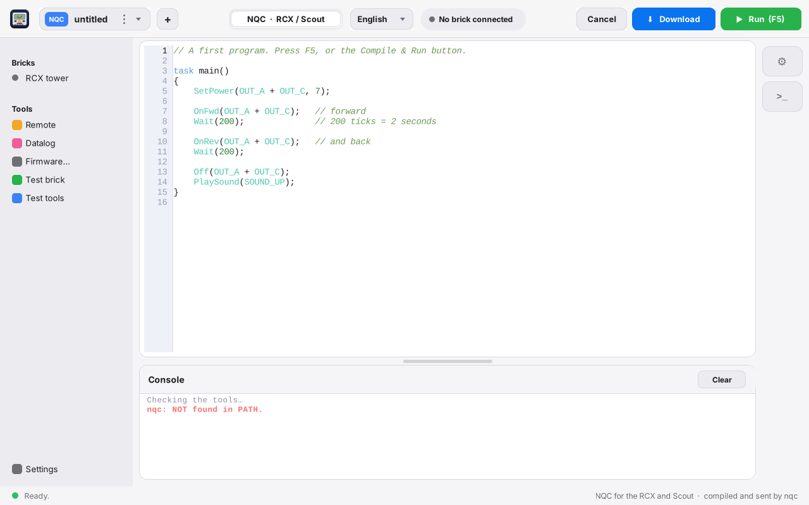
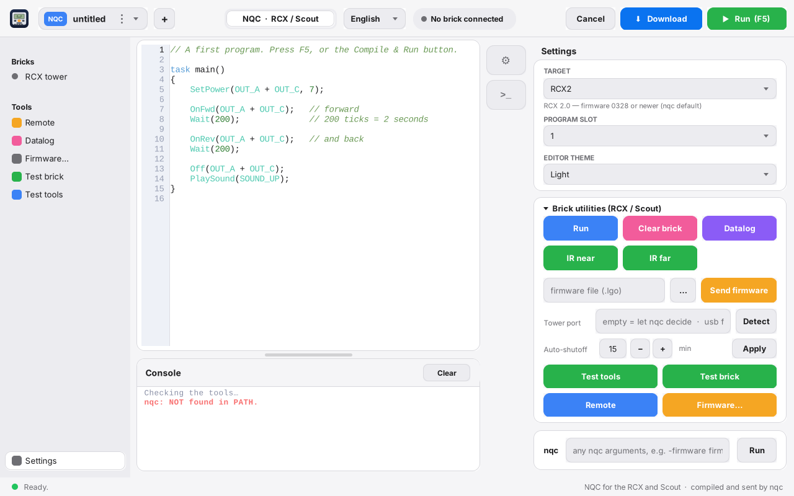
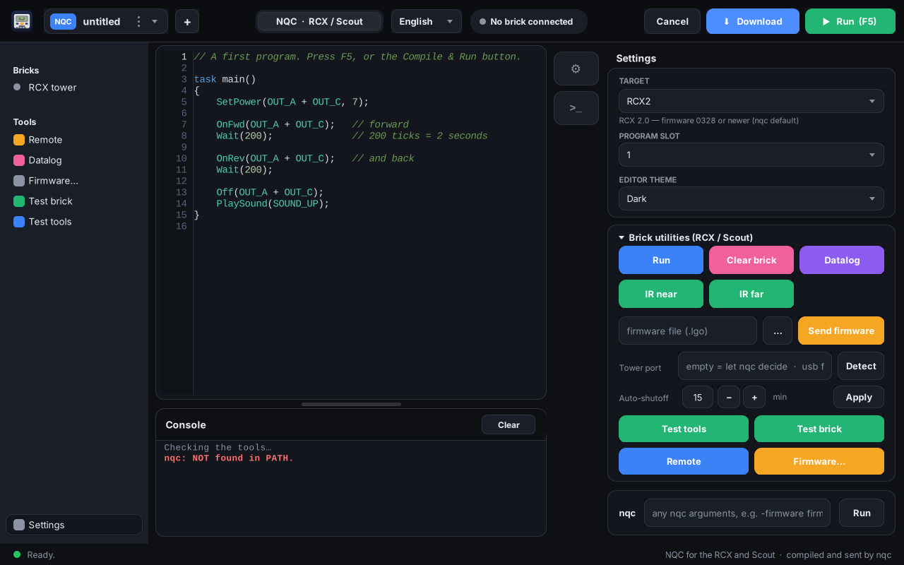
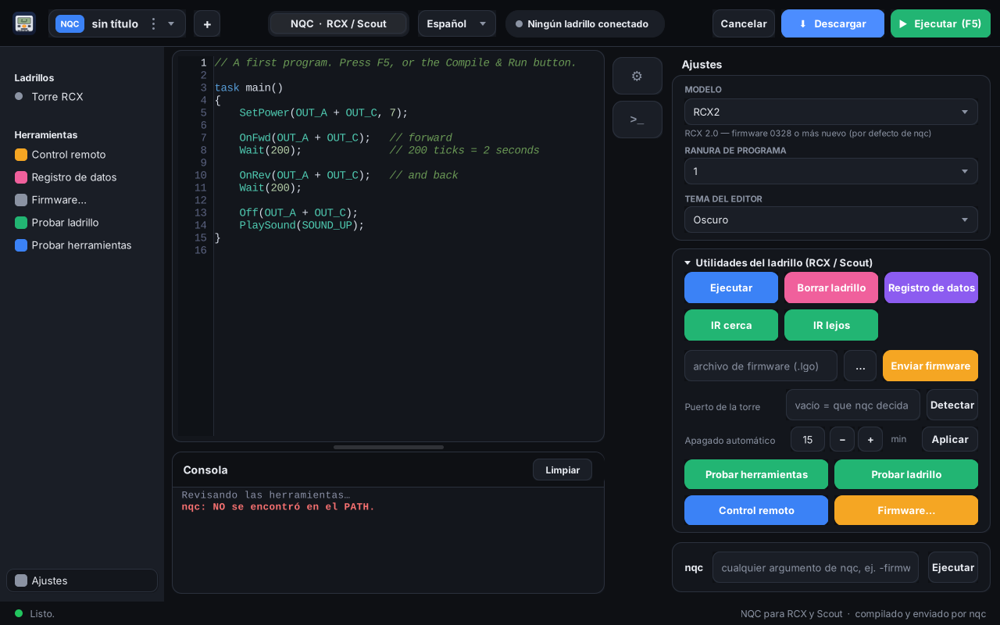
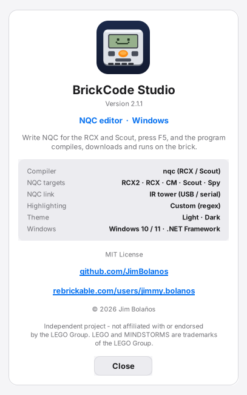

# BrickCode Studio Win11

An NQC editor for the LEGO RCX and Scout, for **Windows 10 and 11**. Write a
program, press **F5**, and it is compiled, downloaded and run on the brick. Every
button on screen is an invocation of `nqc.exe`; there is nothing else in the middle.

This is the Windows build of [BrickCode Studio](https://github.com/JimBolanos/brickcode-studio),
with the same interface, and NQC only — no NXC, no NXT. It carries everything it
needs: the compiler, the RCX firmware files, the USB libraries and the tower driver.

> Continues from [rcx-tower-gui](https://github.com/JimBolanos/rcx-tower-gui), the
> earlier version of the same idea.



---

## You need the LEGO IR tower

The RCX and the Scout have **no data cable**. There is no USB socket on the brick
and never was. Everything — your program, the firmware, remote-control commands —
travels as **infrared light**, the same way a TV remote works.

So the tower is not an accessory, it is the only way in:

```
   your PC  ──USB──▶  LEGO IR tower  ))) infrared (((  ▶  RCX / Scout
```

Without one, this editor still writes and compiles NQC perfectly well, but nothing
ever reaches the brick.

### The two towers

| | USB tower | Serial tower |
|---|---|---|
| LEGO part | `x431c01` | `9713` |
| Came in sets | 3804, 9786, 9794 | 9719, 9785, 9790, 9793 |
| Plug | USB | DE-9 serial |
| Power | from the USB port | **needs a 9 V battery** |
| USB ID | `0694:0001` | — |
| On Windows 10/11 | needs the libusbK driver (Zadig, included here) | works as it always did |
| In this app | `nqc` compiles, `rcx_tool.py` sends | `nqc` does everything |

The USB one is the common one on the second-hand market and is what this package is
set up for. If you have the serial one, a USB-to-serial adapter works; type its COM
port into **Tower port** under Settings and the app uses `nqc` for everything.

### Getting the brick to answer

- Switch the RCX on — the display must show something.
- Point the brick's **IR window** at the tower's, roughly 10–25 cm away.
- Keep them facing each other. Infrared is directional and bounces off walls.
- Avoid strong sunlight or a fluorescent lamp right above them; both drown the signal.
- Fresh batteries in the brick. A tired RCX answers the ping and then fails halfway
  through a firmware upload.

Press **Test brick** in the app to check all of this before blaming the software.

---

## Get it running

Take the whole folder in [`package/BrickCodeStudio`](package/BrickCodeStudio) — it
has everything: the editor, `nqc.exe`, the RCX firmware files, pyusb, libusb and
the driver installer. The only thing you add is **Python 3 from the Microsoft
Store**.

1. Plug in the USB IR tower.
2. Install the tower driver: `driver\zadig-2.9.exe`, following
   [`driver/README-driver.txt`](package/BrickCodeStudio/driver/README-driver.txt).
3. Run `BrickCodeStudio.exe`.
4. Press **Test tools** — it should find nqc.exe, python, rcx_tool.py,
   libusb-1.0.dll and pyusb.
5. Press **Test brick** with the RCX on and pointed at the tower.

Nothing is installed, and nothing is written outside
`%APPDATA%\BrickCodeStudio\settings.txt`, which remembers your window size,
language, theme, target and tower port.

If you only want the editor, `dist/BrickCodeStudio.exe` is the bare exe; put
`nqc.exe` beside it.

## About the USB tower on Windows 10 and 11

`nqc` opens the tower as `\\.\LEGOTOWER1` — LEGO's own driver, which was never
signed for 64-bit Windows 10 or 11. So **nqc alone cannot download to the brick
on a modern Windows**, whatever you do to it.

The way round it, the one
[beckmx](https://github.com/beckmx/lego-tower-rcx) worked out, is to bind the
tower to **libusbK** with Zadig and talk to it from Python. So in this build:

- **nqc.exe compiles** — that part is untouched and works perfectly.
- **`rcx_tool.py` carries the program to the brick** over libusbK.

Both are driven by the app; you never type either command. pyusb is bundled, so
there is no `pip install` step.

**With a serial tower none of this applies.** Type the port (`COM1`, say) into
**Tower port** under Settings and the app uses `nqc` for everything, directly.

## The window

**Top bar** — the file chip (click it for New / Open / Save / Save as / About),
`+` for a new program, the `NQC · RCX / Scout` mode, the language, the brick status,
and **Cancel**, **Download** and **Run (F5)**.

**Left sidebar** — the RCX tower with its status dot, and the tools: Remote, Datalog,
Firmware, Test brick, Test tools. **Settings** at the bottom opens the panel on the right.

**Editor** — NQC highlighting and line numbers. When `nqc` reports an error, the line
is marked and scrolled into view.

**Console** — everything `nqc` prints, under the command that produced it.

**Settings panel** — target (`-T`), program slot (`-pgm`), editor theme, the brick
utilities, the tower port, auto-shutoff, and a free `nqc` argument box with
up/down history.

| Light | Dark |
|---|---|
|  |  |

## What each button runs

| Button | USB tower (libusbK) | Serial tower (COM port) |
|---|---|---|
| Run (F5) | `nqc -T<t> -O prog.rcx prog.nqc` → `rcx_tool download prog.rcx <slot>` → `rcx_tool run <slot>` | `nqc -T<t> -S<port> -pgm <slot> -d prog.nqc -run` |
| Download | the same, without the last step | `nqc -T<t> -S<port> -pgm <slot> -d prog.nqc` |
| Run (utilities) | `rcx_tool run <slot>` | `nqc -T<t> -pgm <slot> -run` |
| Clear brick | `rcx_tool clear <slot>` | `nqc -T<t> -pgm <slot> -clear` |
| Datalog | `rcx_tool datalog` | `nqc -T<t> -datalog` |
| IR near / far | `rcx_tool near` / `far` | `nqc -T<t> -near` / `-far` |
| Send firmware | `rcx_tool firmware <file.lgo>` | `nqc -T<t> -firmware <file.lgo>` |
| Auto-shutoff | `rcx_tool sleep <minutes>` | `nqc -T<t> -sleep <minutes>` |
| Remote | `rcx_tool remote <mask>` | `nqc -T<t> -raw1 D2<mask>` |
| Test brick | `rcx_tool ping` | `nqc -T<t> -near` |
| Detect | `rcx_tool tower` | reads `RCX_PORT` |

The free `nqc` box at the bottom of the settings panel always goes straight to
`nqc`, with up/down history.

### The rcx_tool.py in this package is patched

It is [beckmx's](https://github.com/beckmx/lego-tower-rcx), with two changes:

- **The program-slot opcode was wrong.** It sent `0x51`, which is *PlaySound*;
  the opcode for Select Program is `0x91`. Downloading to any slot other than 1
  therefore never landed where it should. Fixed.
- Added the commands the interface needs: `run`, `stop`, `clear`, `near`, `far`,
  `sleep`, `battery`, `datalog` and `remote`. Every opcode follows the nqc
  source (`rcxlib/RCX_Constants.h`).

[`package/patch_rcx_tool.py`](package/patch_rcx_tool.py) applies those changes to
a fresh copy, so you can see exactly what was touched.

## Languages

English and Spanish, switched from the top bar — the whole interface, the console
messages and the dialogs.



## Build from source

```
build.bat
```

It uses the C# compiler that ships with the .NET Framework, so there is nothing to
install. The sources are five files under `src/`:

| File | What is in it |
|---|---|
| `Core.cs` | constants, translations, palette, drawing helpers, the app icon |
| `Controls.cs` | buttons, fields, drop-downs, cards, the editor, the console |
| `Chrome.cs` | toolbar, file chip, sidebar, status bar |
| `Panels.cs` | settings panel, Remote window, About window |
| `Main.cs` | layout, actions and the nqc runner |

The icon is drawn in code with GDI+, ported from the cairo original, so it is the
same brick at every size.

## About



---

MIT License · © 2026 Jim Bolaños · [github.com/JimBolanos](https://github.com/JimBolanos)

Independent project — not affiliated with or endorsed by the LEGO Group.
LEGO and MINDSTORMS are trademarks of the LEGO Group.
